# Gallery

Every case, side by side: vanilla Codex (baseline) and Codex with each version of the skill. Run 1 is shown; run 2 is linked. Desktop screenshots at 1440px, full page; click through for phone (390px) and dark-mode shots, the agent's files, and its final message. Logos show a presentation sheet; animations a 10-frame filmstrip. See [README.md](README.md) for method and results.

## booking-flow

> Create a multi-step booking flow for a home-cleaning service: contact details, home details (bedrooms, bathrooms, pets), then pick a date and time slot, then a review step. It needs to work well on phones. Single file: index.html.

| baseline (iteration 1) | skill v1 | baseline (iteration 2) | skill v2 | skill v3 | skill v4 |
|---|---|---|---|---|---|
| <a href="iteration-1/booking-flow/baseline/run-1/shots/desktop-light.jpg">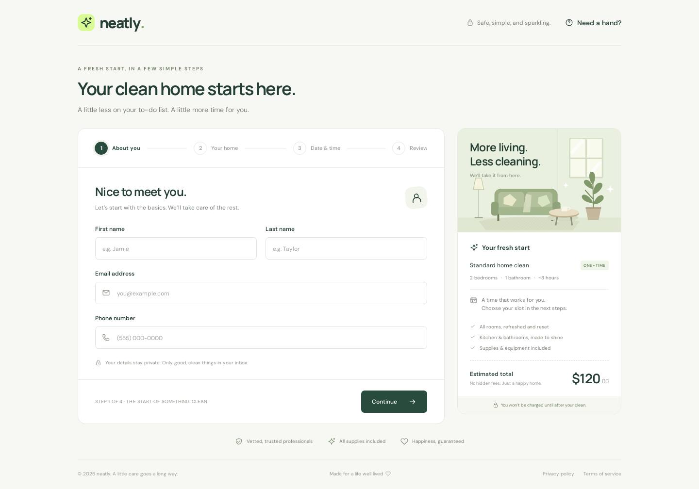</a> [phone](iteration-1/booking-flow/baseline/run-1/shots/mobile-light.jpg) · [files](iteration-1/booking-flow/baseline/run-1/output/) · [run 2](iteration-1/booking-flow/baseline/run-2/shots/desktop-light.jpg) | <a href="iteration-1/booking-flow/with-skill/run-1/shots/desktop-light.jpg">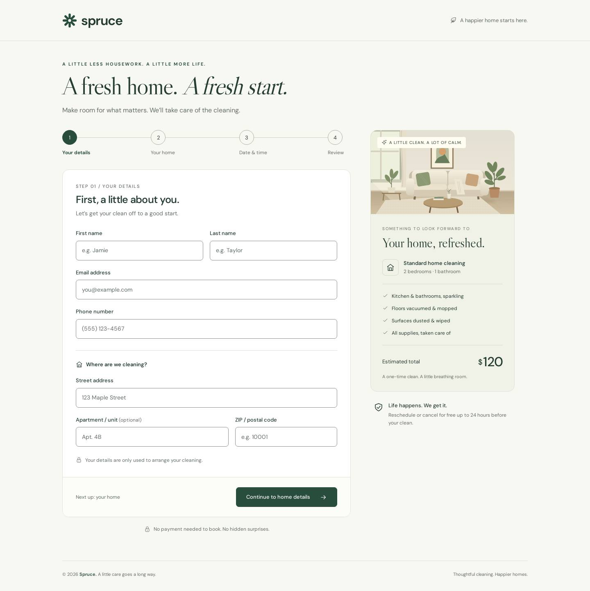</a> [phone](iteration-1/booking-flow/with-skill/run-1/shots/mobile-light.jpg) · [files](iteration-1/booking-flow/with-skill/run-1/output/) · [run 2](iteration-1/booking-flow/with-skill/run-2/shots/desktop-light.jpg) | <a href="iteration-2/booking-flow/baseline/run-1/shots/desktop-light.jpg">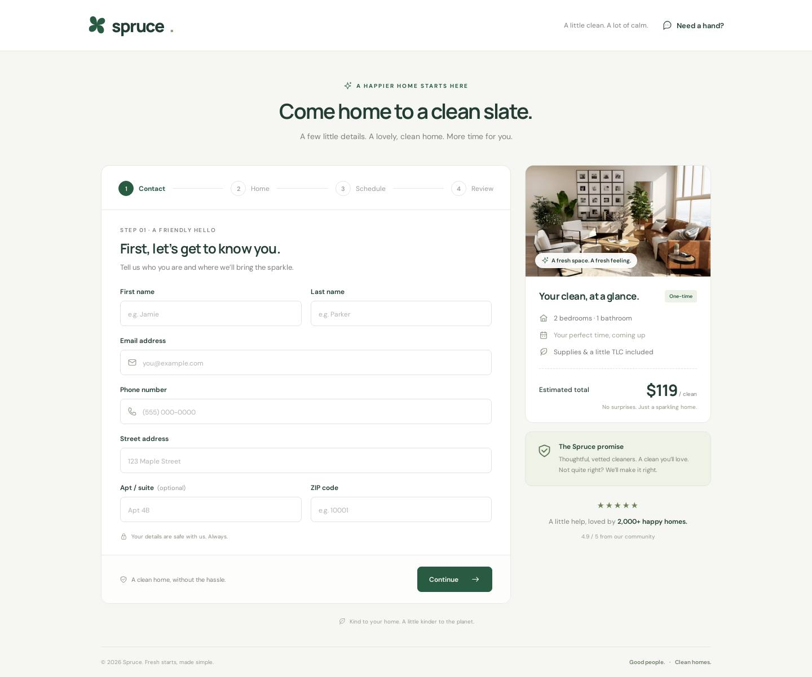</a> [phone](iteration-2/booking-flow/baseline/run-1/shots/mobile-light.jpg) · [files](iteration-2/booking-flow/baseline/run-1/output/) · [run 2](iteration-2/booking-flow/baseline/run-2/shots/desktop-light.jpg) | <a href="iteration-2/booking-flow/with-skill/run-1/shots/desktop-light.jpg">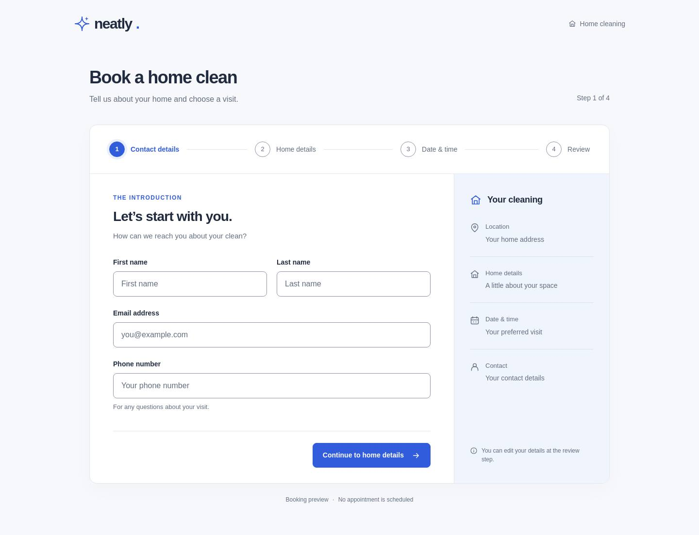</a> [phone](iteration-2/booking-flow/with-skill/run-1/shots/mobile-light.jpg) · [files](iteration-2/booking-flow/with-skill/run-1/output/) · [run 2](iteration-2/booking-flow/with-skill/run-2/shots/desktop-light.jpg) | <a href="iteration-3/booking-flow/with-skill/run-1/shots/desktop-light.jpg">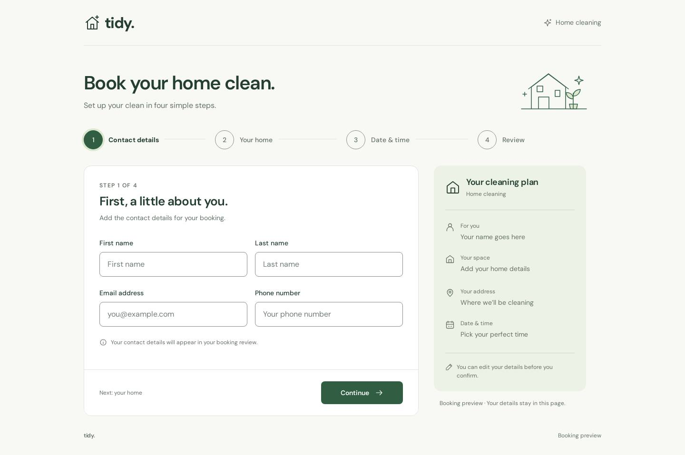</a> [phone](iteration-3/booking-flow/with-skill/run-1/shots/mobile-light.jpg) · [files](iteration-3/booking-flow/with-skill/run-1/output/) · [run 2](iteration-3/booking-flow/with-skill/run-2/shots/desktop-light.jpg) | <a href="iteration-4/booking-flow/with-skill/run-1/shots/desktop-light.jpg">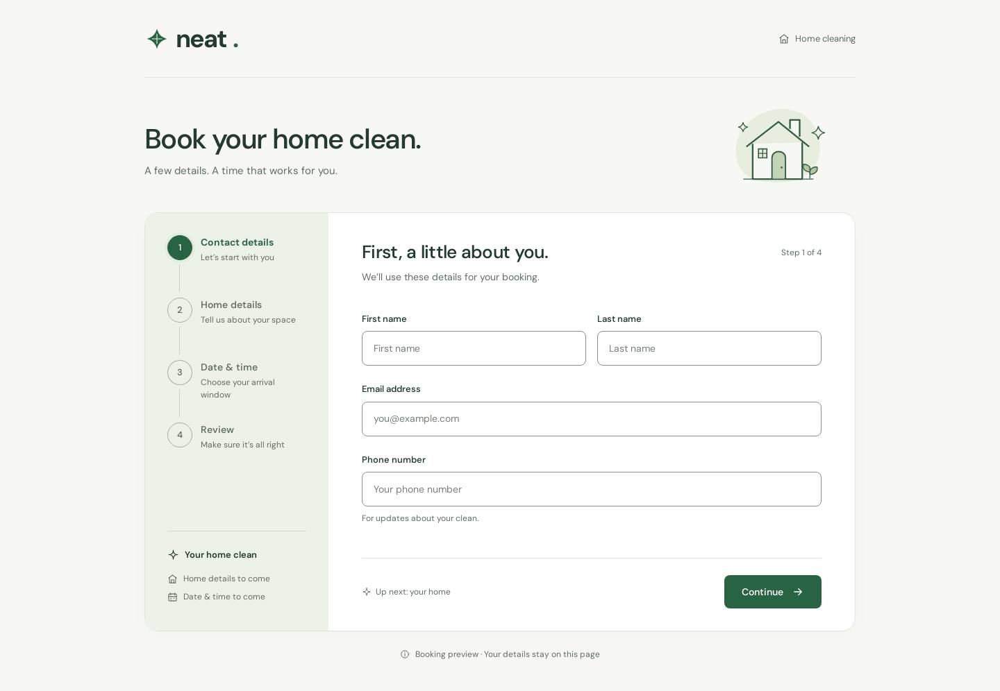</a> [phone](iteration-4/booking-flow/with-skill/run-1/shots/mobile-light.jpg) · [files](iteration-4/booking-flow/with-skill/run-1/output/) · [run 2](iteration-4/booking-flow/with-skill/run-2/shots/desktop-light.jpg) |

## invoice-dashboard

> Build the main screen of a web app for freelancers to track invoices: what they're owed, what's overdue, a list of recent invoices (client, amount, status, due date), and a way to create a new invoice. Use realistic sample data. Single file: index.html.

| baseline (iteration 1) | skill v1 | baseline (iteration 2) | skill v2 | skill v3 | skill v4 |
|---|---|---|---|---|---|
| <a href="iteration-1/invoice-dashboard/baseline/run-1/shots/desktop-light.jpg">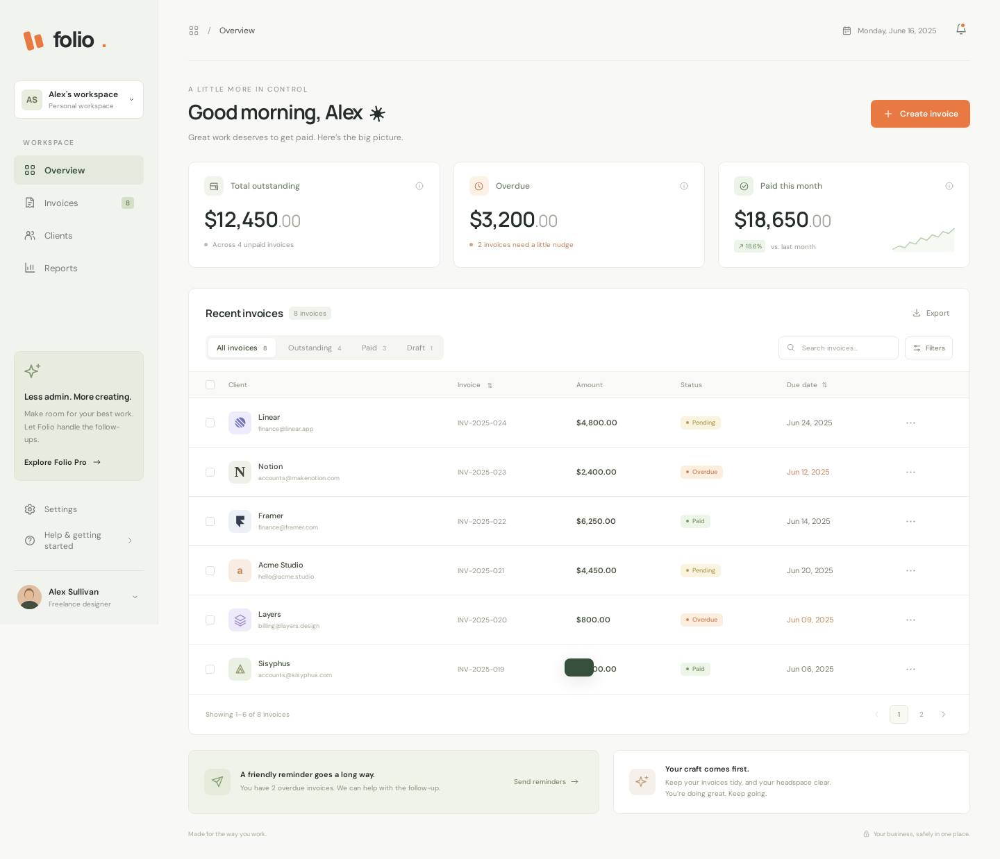</a> [phone](iteration-1/invoice-dashboard/baseline/run-1/shots/mobile-light.jpg) · [files](iteration-1/invoice-dashboard/baseline/run-1/output/) · [run 2](iteration-1/invoice-dashboard/baseline/run-2/shots/desktop-light.jpg) | <a href="iteration-1/invoice-dashboard/with-skill/run-1/shots/desktop-light.jpg">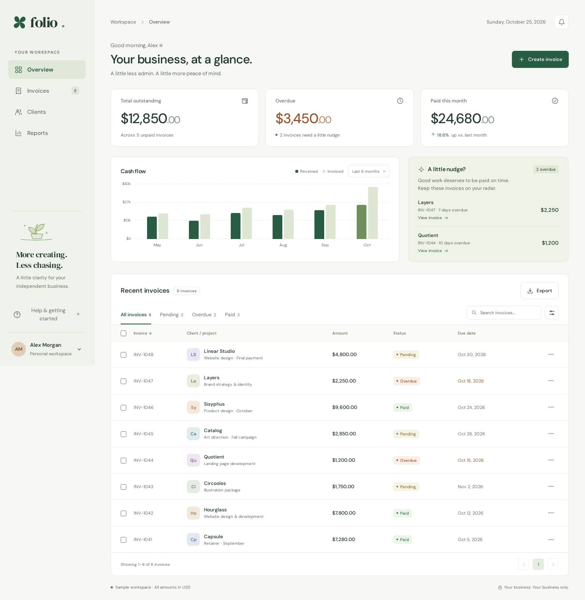</a> [phone](iteration-1/invoice-dashboard/with-skill/run-1/shots/mobile-light.jpg) · [files](iteration-1/invoice-dashboard/with-skill/run-1/output/) · [run 2](iteration-1/invoice-dashboard/with-skill/run-2/shots/desktop-light.jpg) | <a href="iteration-2/invoice-dashboard/baseline/run-1/shots/desktop-light.jpg">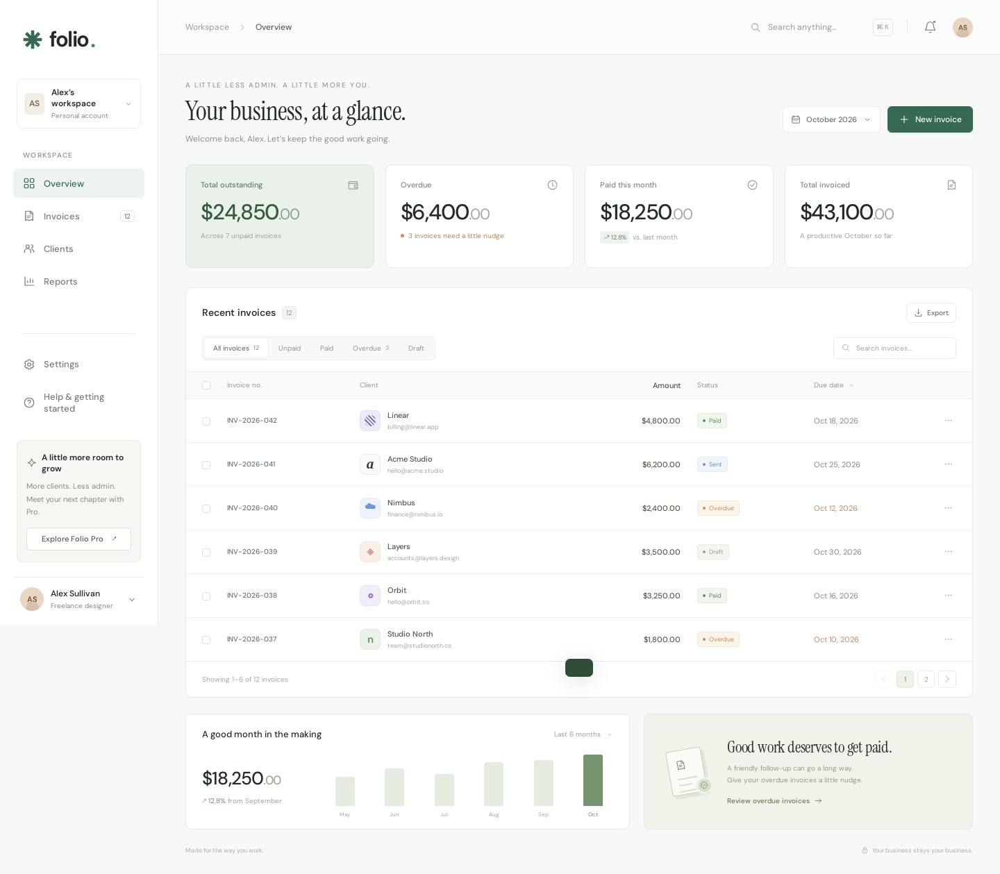</a> [phone](iteration-2/invoice-dashboard/baseline/run-1/shots/mobile-light.jpg) · [files](iteration-2/invoice-dashboard/baseline/run-1/output/) · [run 2](iteration-2/invoice-dashboard/baseline/run-2/shots/desktop-light.jpg) | <a href="iteration-2/invoice-dashboard/with-skill/run-1/shots/desktop-light.jpg">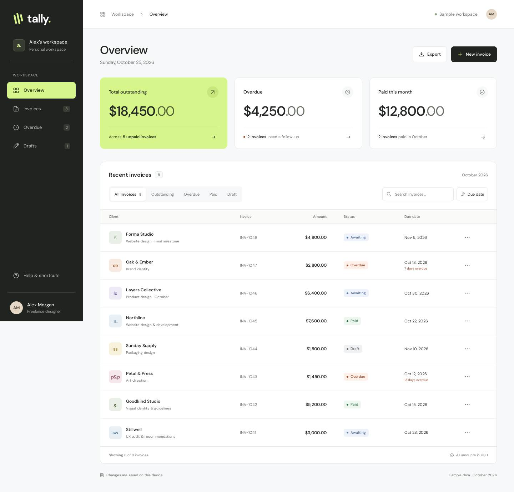</a> [phone](iteration-2/invoice-dashboard/with-skill/run-1/shots/mobile-light.jpg) · [files](iteration-2/invoice-dashboard/with-skill/run-1/output/) · [run 2](iteration-2/invoice-dashboard/with-skill/run-2/shots/desktop-light.jpg) | <a href="iteration-3/invoice-dashboard/with-skill/run-1/shots/desktop-light.jpg">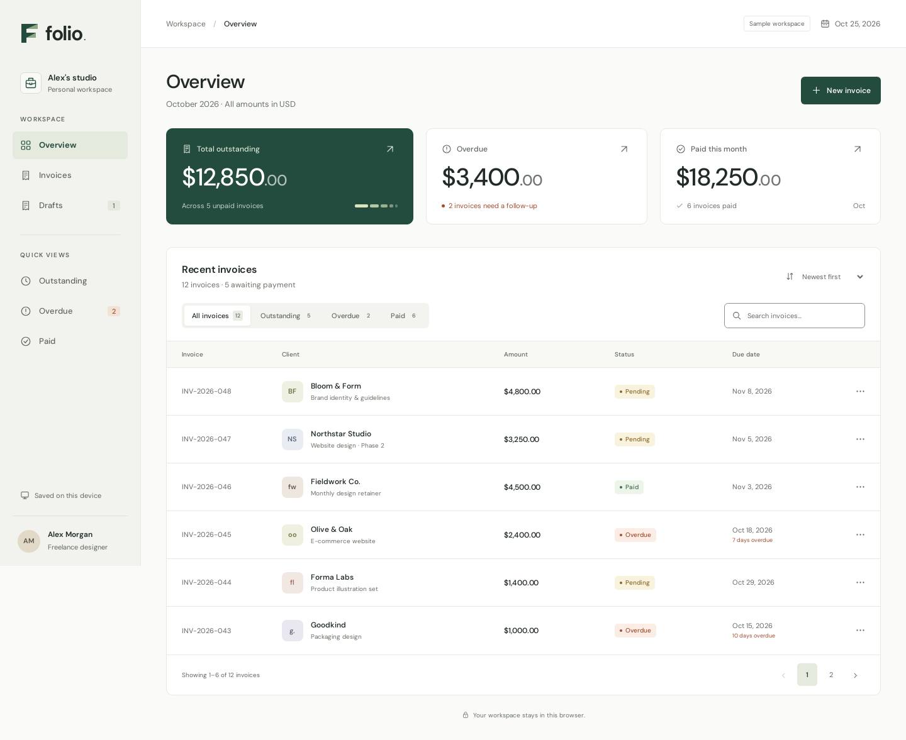</a> [phone](iteration-3/invoice-dashboard/with-skill/run-1/shots/mobile-light.jpg) · [files](iteration-3/invoice-dashboard/with-skill/run-1/output/) · [run 2](iteration-3/invoice-dashboard/with-skill/run-2/shots/desktop-light.jpg) | <a href="iteration-4/invoice-dashboard/with-skill/run-1/shots/desktop-light.jpg">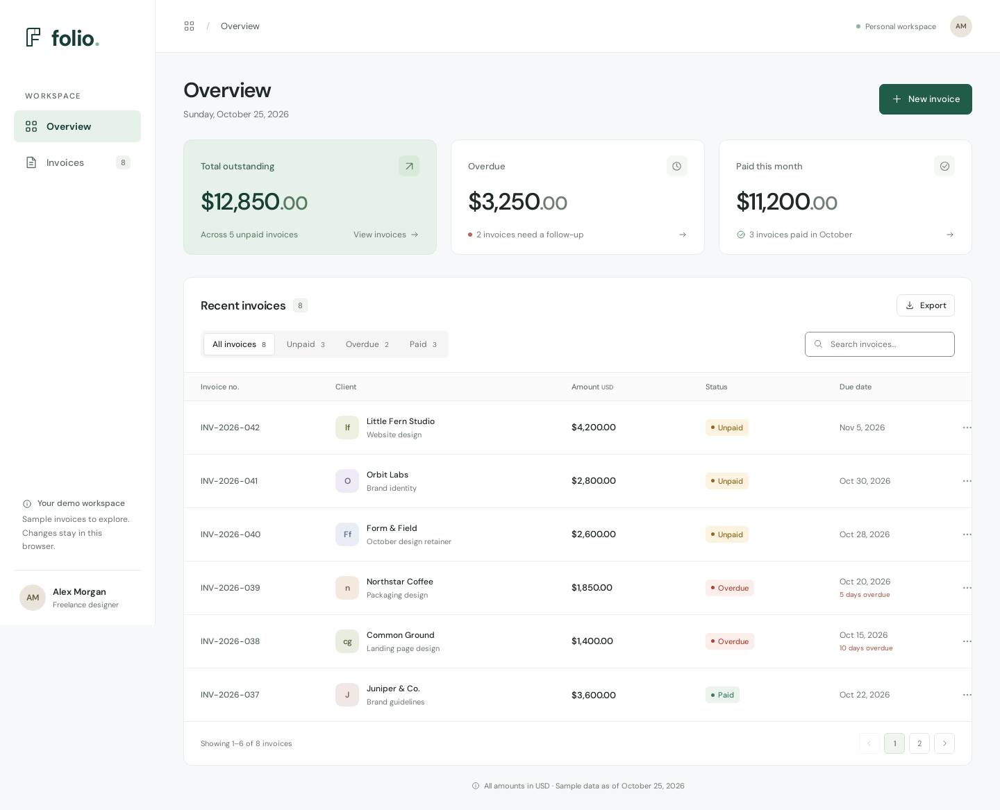</a> [phone](iteration-4/invoice-dashboard/with-skill/run-1/shots/mobile-light.jpg) · [files](iteration-4/invoice-dashboard/with-skill/run-1/output/) · [run 2](iteration-4/invoice-dashboard/with-skill/run-2/shots/desktop-light.jpg) |

## landing-page

> Make a landing page for Tidepool, an app that helps small climbing gyms run memberships, class bookings, and day passes. Put everything in index.html (inline CSS and JS are fine).

| baseline (iteration 1) | skill v1 | baseline (iteration 2) | skill v2 | skill v3 | skill v4 |
|---|---|---|---|---|---|
| <a href="iteration-1/landing-page/baseline/run-1/shots/desktop-light.jpg">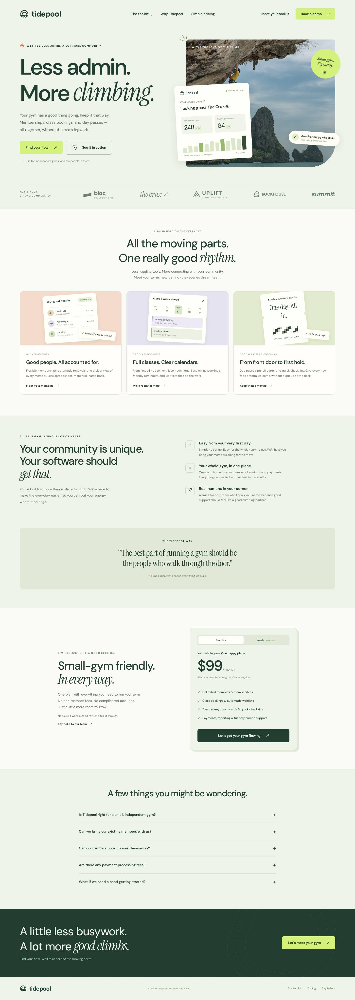</a> [phone](iteration-1/landing-page/baseline/run-1/shots/mobile-light.jpg) · [files](iteration-1/landing-page/baseline/run-1/output/) · [run 2](iteration-1/landing-page/baseline/run-2/shots/desktop-light.jpg) | <a href="iteration-1/landing-page/with-skill/run-1/shots/desktop-light.jpg">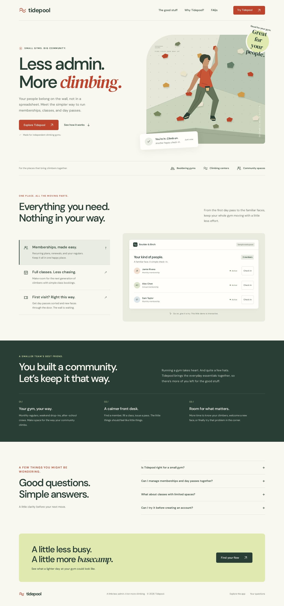</a> [phone](iteration-1/landing-page/with-skill/run-1/shots/mobile-light.jpg) · [files](iteration-1/landing-page/with-skill/run-1/output/) · [run 2](iteration-1/landing-page/with-skill/run-2/shots/desktop-light.jpg) | <a href="iteration-2/landing-page/baseline/run-1/shots/desktop-light.jpg">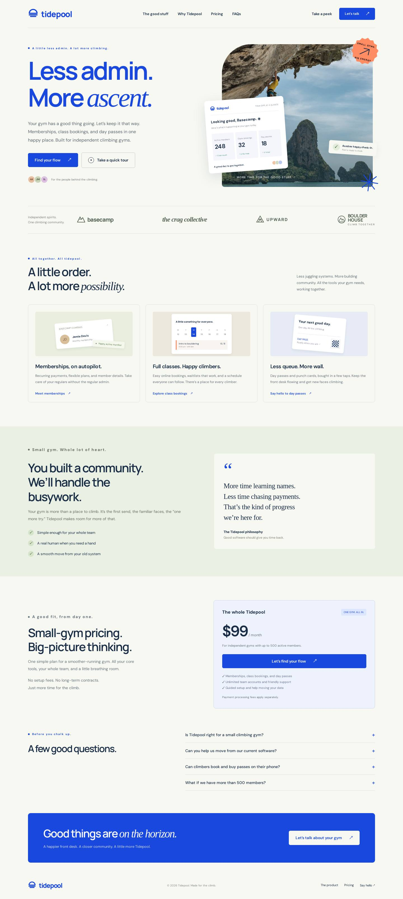</a> [phone](iteration-2/landing-page/baseline/run-1/shots/mobile-light.jpg) · [files](iteration-2/landing-page/baseline/run-1/output/) · [run 2](iteration-2/landing-page/baseline/run-2/shots/desktop-light.jpg) | <a href="iteration-2/landing-page/with-skill/run-1/shots/desktop-light.jpg">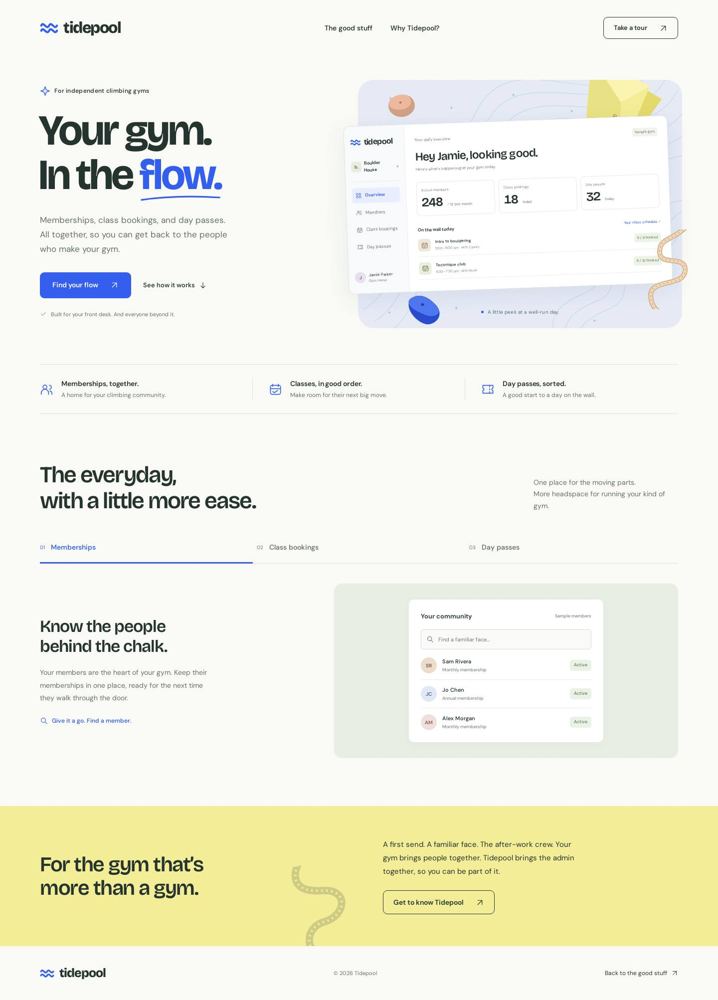</a> [phone](iteration-2/landing-page/with-skill/run-1/shots/mobile-light.jpg) · [files](iteration-2/landing-page/with-skill/run-1/output/) · [run 2](iteration-2/landing-page/with-skill/run-2/shots/desktop-light.jpg) | <a href="iteration-3/landing-page/with-skill/run-1/shots/desktop-light.jpg">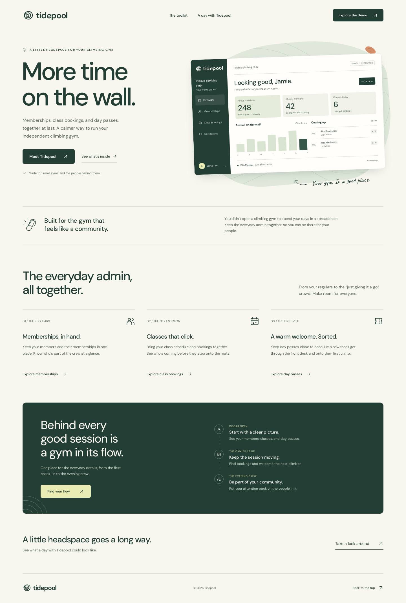</a> [phone](iteration-3/landing-page/with-skill/run-1/shots/mobile-light.jpg) · [files](iteration-3/landing-page/with-skill/run-1/output/) · [run 2](iteration-3/landing-page/with-skill/run-2/shots/desktop-light.jpg) | <a href="iteration-4/landing-page/with-skill/run-1/shots/desktop-light.jpg">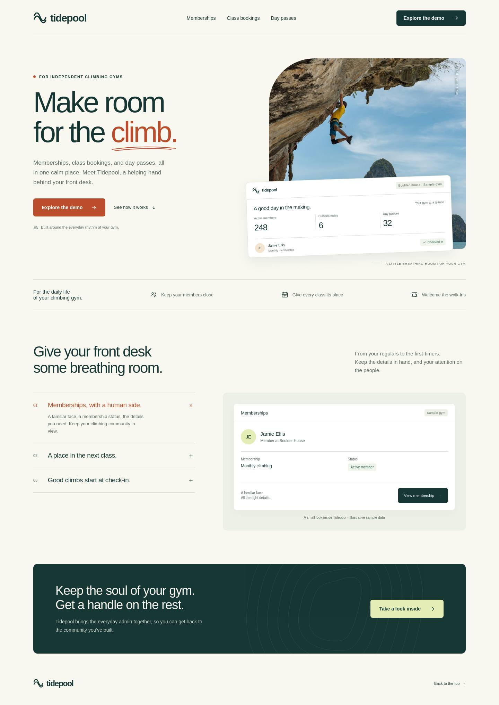</a> [phone](iteration-4/landing-page/with-skill/run-1/shots/mobile-light.jpg) · [files](iteration-4/landing-page/with-skill/run-1/output/) · [run 2](iteration-4/landing-page/with-skill/run-2/shots/desktop-light.jpg) |

## logo

> Design a logo for Fernway, an independent bookshop with a small café in Portland, Oregon. Save the full logo as logo.svg and an icon-only version as mark.svg that still works as a 16px favicon.

| baseline (iteration 1) | skill v1 | baseline (iteration 2) | skill v2 | skill v3 | skill v4 |
|---|---|---|---|---|---|
| <a href="iteration-1/logo/baseline/run-1/shots/sheet.jpg">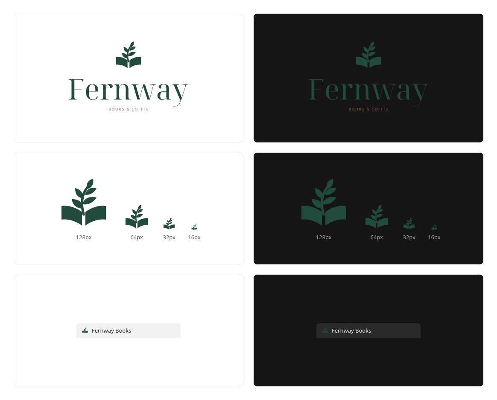</a> [files](iteration-1/logo/baseline/run-1/output/) · [run 2](iteration-1/logo/baseline/run-2/shots/sheet.jpg) | <a href="iteration-1/logo/with-skill/run-1/shots/sheet.jpg">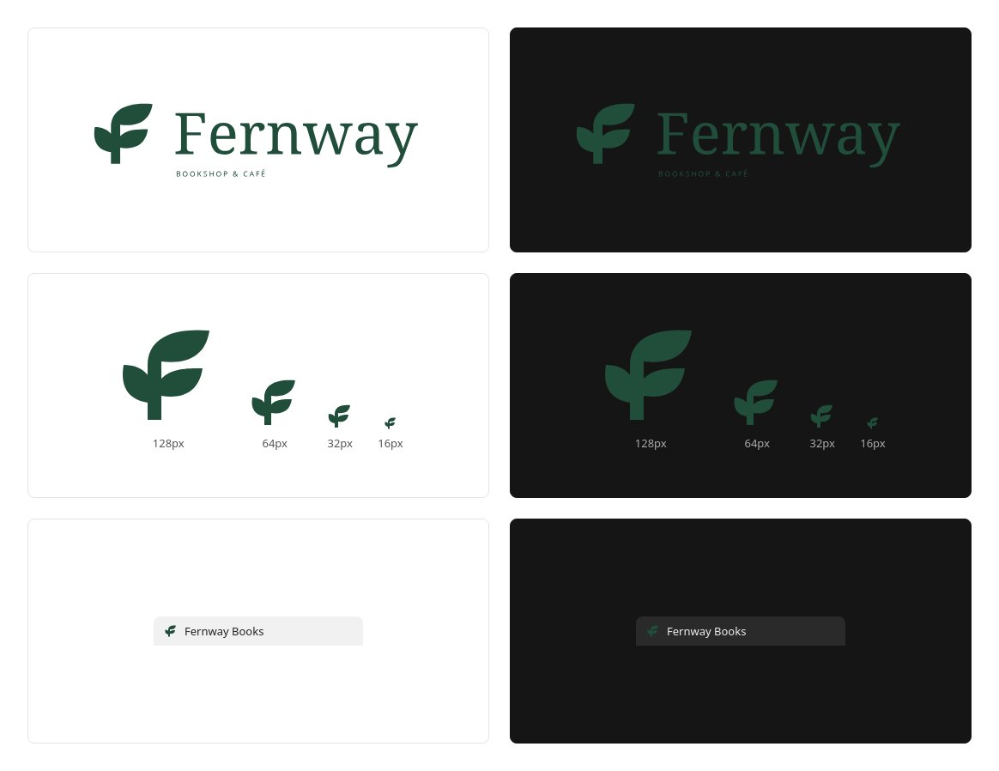</a> [files](iteration-1/logo/with-skill/run-1/output/) · [run 2](iteration-1/logo/with-skill/run-2/shots/sheet.jpg) | <a href="iteration-2/logo/baseline/run-1/shots/sheet.jpg">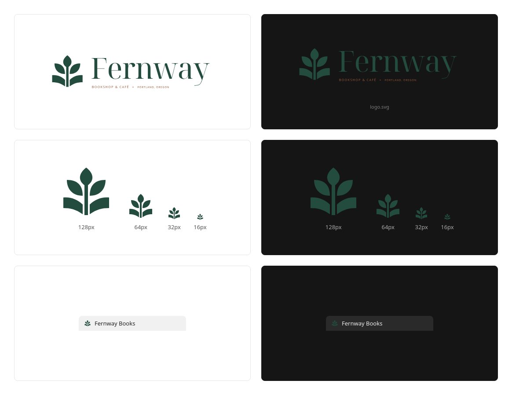</a> [files](iteration-2/logo/baseline/run-1/output/) · [run 2](iteration-2/logo/baseline/run-2/shots/sheet.jpg) | <a href="iteration-2/logo/with-skill/run-1/shots/sheet.jpg">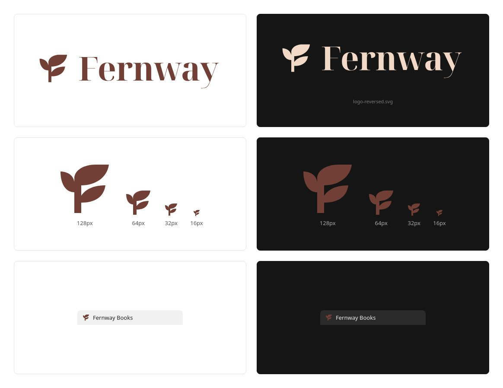</a> [files](iteration-2/logo/with-skill/run-1/output/) · [run 2](iteration-2/logo/with-skill/run-2/shots/sheet.jpg) | <a href="iteration-3/logo/with-skill/run-1/shots/sheet.jpg">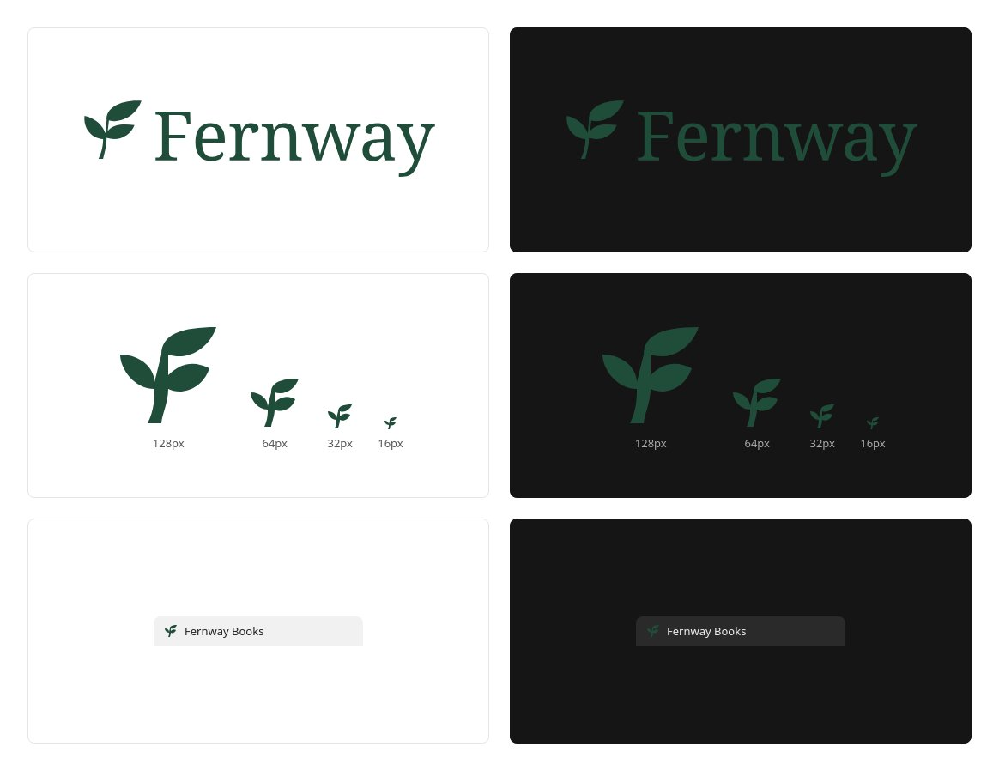</a> [files](iteration-3/logo/with-skill/run-1/output/) · [run 2](iteration-3/logo/with-skill/run-2/shots/sheet.jpg) | <a href="iteration-4/logo/with-skill/run-1/shots/sheet.jpg">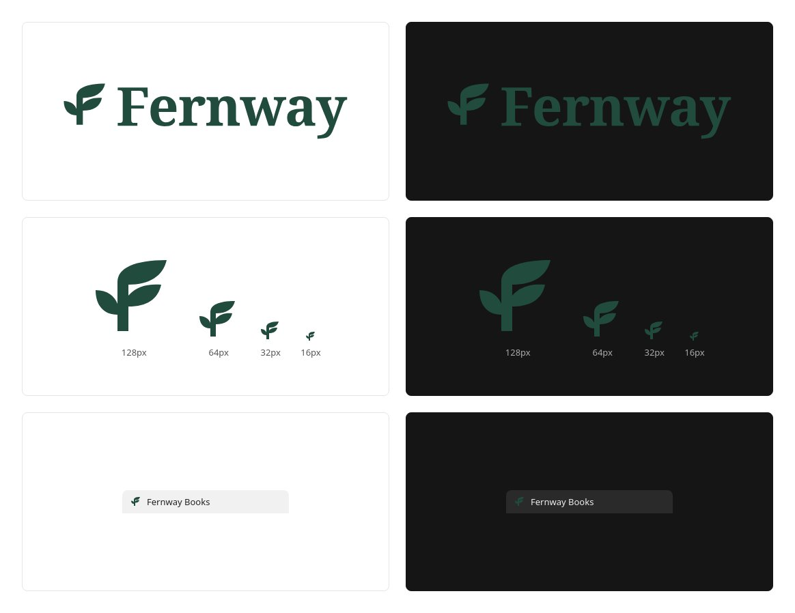</a> [files](iteration-4/logo/with-skill/run-1/output/) · [run 2](iteration-4/logo/with-skill/run-2/shots/sheet.jpg) |

## pricing-restyle

> Our pricing page (index.html) looks amateurish. Make it look professional, then tell me briefly what you changed and why.

| baseline (iteration 1) | skill v1 | baseline (iteration 2) | skill v2 | skill v3 | skill v4 |
|---|---|---|---|---|---|
| <a href="iteration-1/pricing-restyle/baseline/run-1/shots/desktop-light.jpg">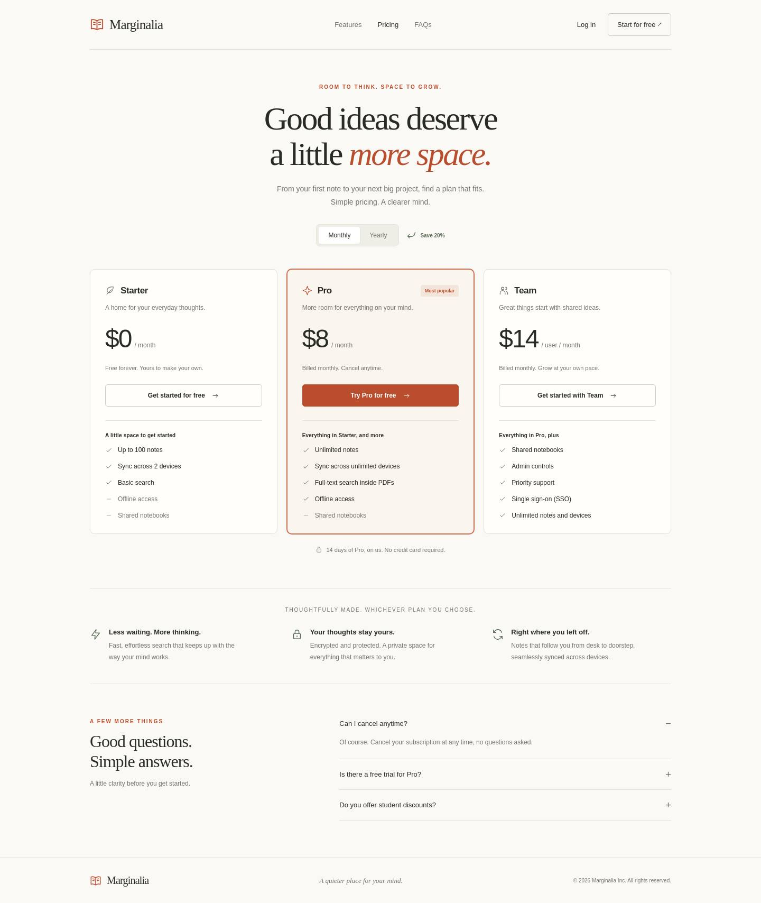</a> [phone](iteration-1/pricing-restyle/baseline/run-1/shots/mobile-light.jpg) · [files](iteration-1/pricing-restyle/baseline/run-1/output/) · [run 2](iteration-1/pricing-restyle/baseline/run-2/shots/desktop-light.jpg) | <a href="iteration-1/pricing-restyle/with-skill/run-1/shots/desktop-light.jpg">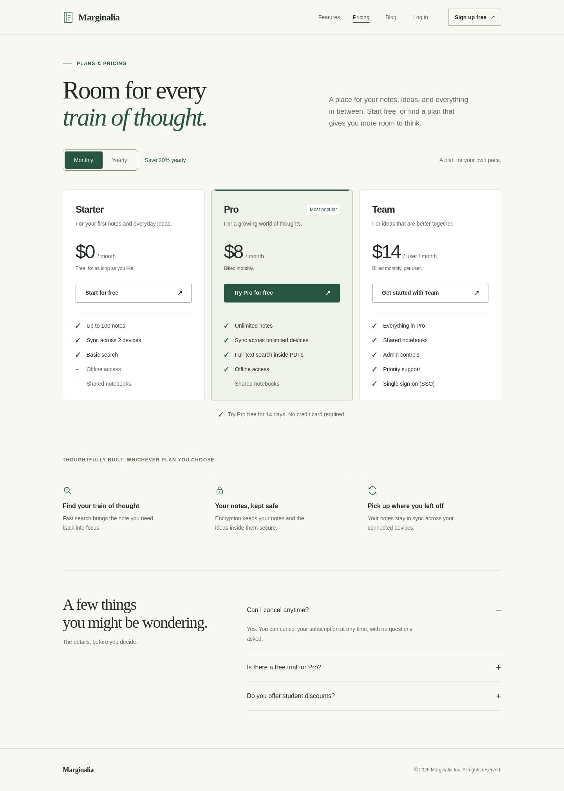</a> [phone](iteration-1/pricing-restyle/with-skill/run-1/shots/mobile-light.jpg) · [files](iteration-1/pricing-restyle/with-skill/run-1/output/) · [run 2](iteration-1/pricing-restyle/with-skill/run-2/shots/desktop-light.jpg) | <a href="iteration-2/pricing-restyle/baseline/run-1/shots/desktop-light.jpg">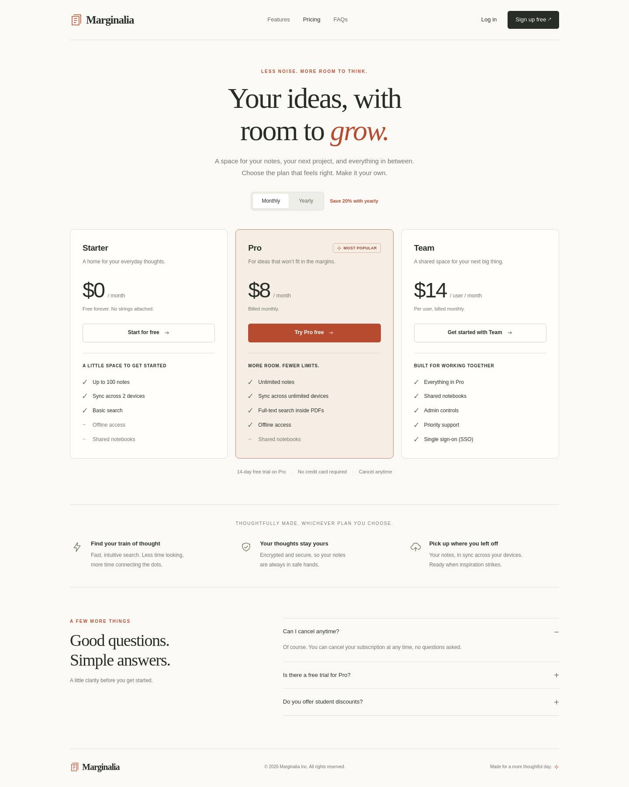</a> [phone](iteration-2/pricing-restyle/baseline/run-1/shots/mobile-light.jpg) · [files](iteration-2/pricing-restyle/baseline/run-1/output/) · [run 2](iteration-2/pricing-restyle/baseline/run-2/shots/desktop-light.jpg) | <a href="iteration-2/pricing-restyle/with-skill/run-1/shots/desktop-light.jpg">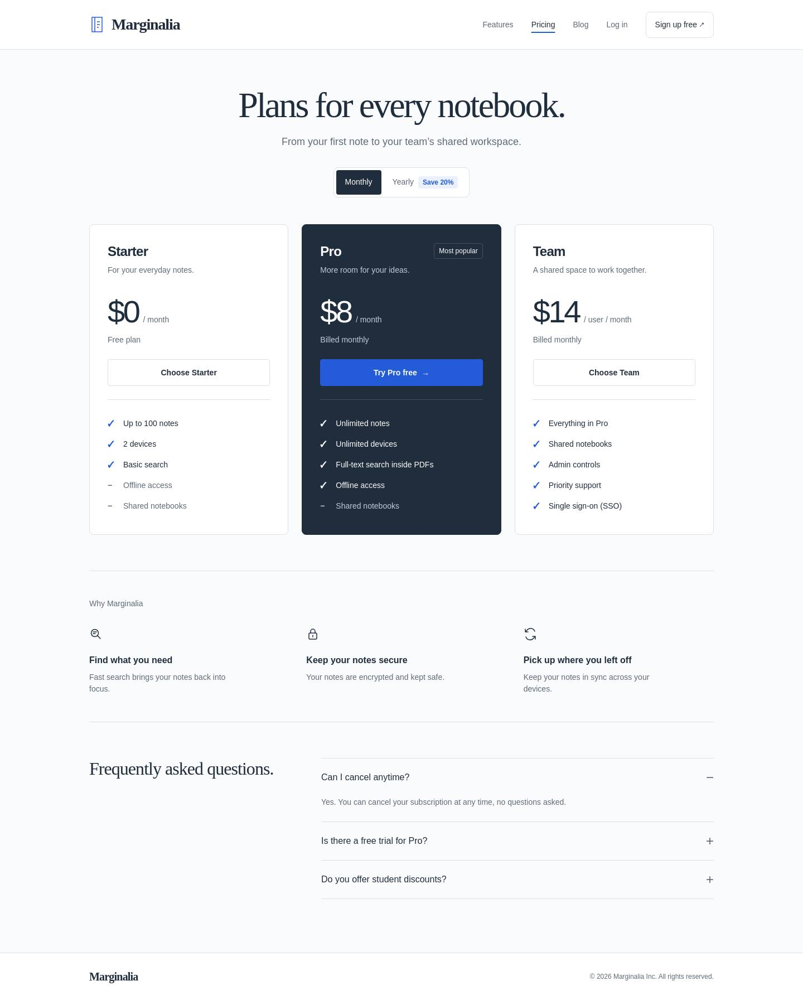</a> [phone](iteration-2/pricing-restyle/with-skill/run-1/shots/mobile-light.jpg) · [files](iteration-2/pricing-restyle/with-skill/run-1/output/) · [run 2](iteration-2/pricing-restyle/with-skill/run-2/shots/desktop-light.jpg) | <a href="iteration-3/pricing-restyle/with-skill/run-1/shots/desktop-light.jpg">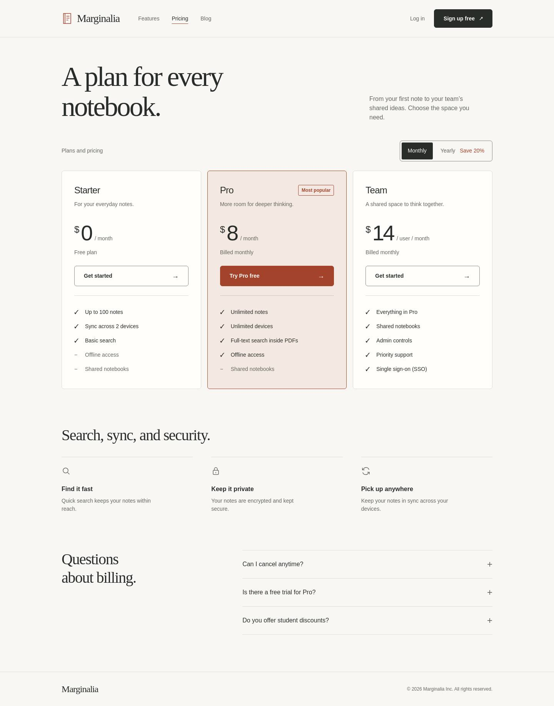</a> [phone](iteration-3/pricing-restyle/with-skill/run-1/shots/mobile-light.jpg) · [files](iteration-3/pricing-restyle/with-skill/run-1/output/) · [run 2](iteration-3/pricing-restyle/with-skill/run-2/shots/desktop-light.jpg) | <a href="iteration-4/pricing-restyle/with-skill/run-1/shots/desktop-light.jpg">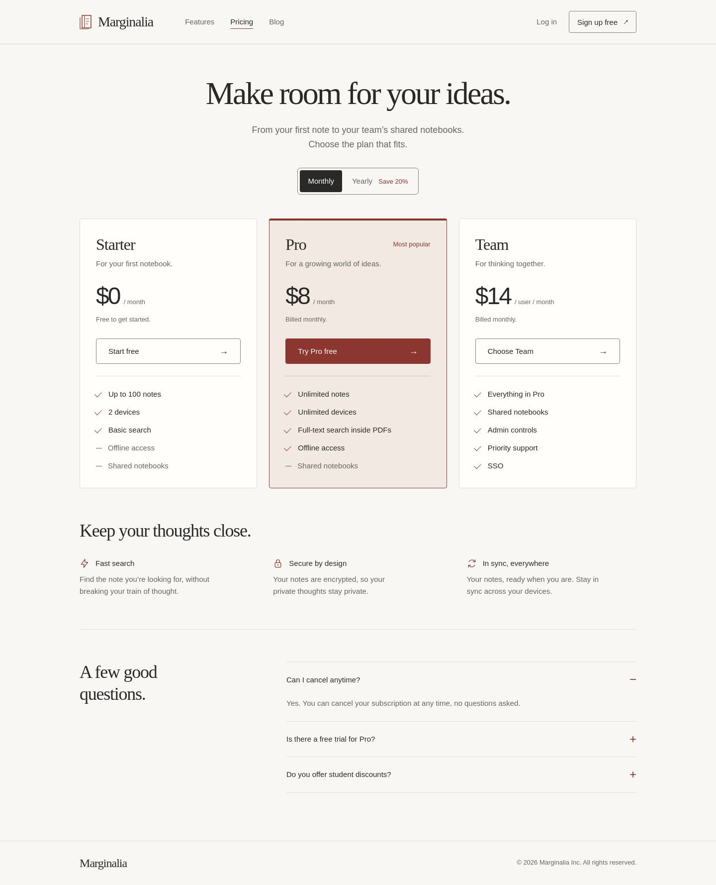</a> [phone](iteration-4/pricing-restyle/with-skill/run-1/shots/mobile-light.jpg) · [files](iteration-4/pricing-restyle/with-skill/run-1/output/) · [run 2](iteration-4/pricing-restyle/with-skill/run-2/shots/desktop-light.jpg) |

## rsvp-page

> Make a page where guests can RSVP to our wedding: Sam & Priya, Saturday June 14, 2027, 4pm, at Hollow Oak Farm in Hudson, NY. Ask for their name, whether they're coming, the number of guests, and any dietary needs. Single file: index.html.

| baseline (iteration 1) | skill v1 | baseline (iteration 2) | skill v2 | skill v3 | skill v4 |
|---|---|---|---|---|---|
| <a href="iteration-1/rsvp-page/baseline/run-1/shots/desktop-light.jpg">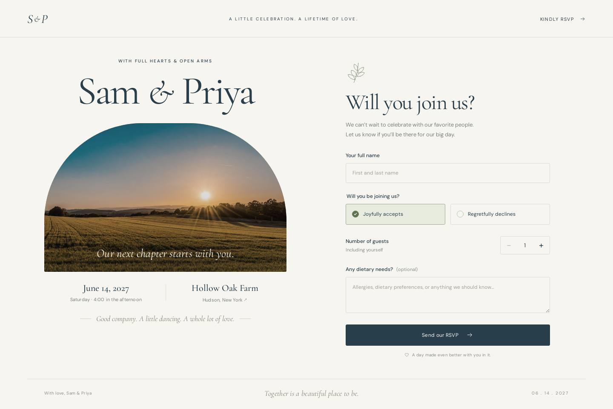</a> [phone](iteration-1/rsvp-page/baseline/run-1/shots/mobile-light.jpg) · [files](iteration-1/rsvp-page/baseline/run-1/output/) · [run 2](iteration-1/rsvp-page/baseline/run-2/shots/desktop-light.jpg) | <a href="iteration-1/rsvp-page/with-skill/run-1/shots/desktop-light.jpg">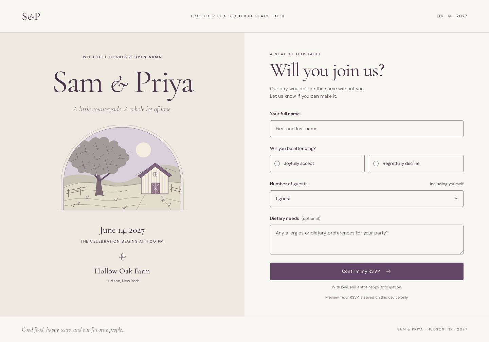</a> [phone](iteration-1/rsvp-page/with-skill/run-1/shots/mobile-light.jpg) · [files](iteration-1/rsvp-page/with-skill/run-1/output/) · [run 2](iteration-1/rsvp-page/with-skill/run-2/shots/desktop-light.jpg) | <a href="iteration-2/rsvp-page/baseline/run-1/shots/desktop-light.jpg">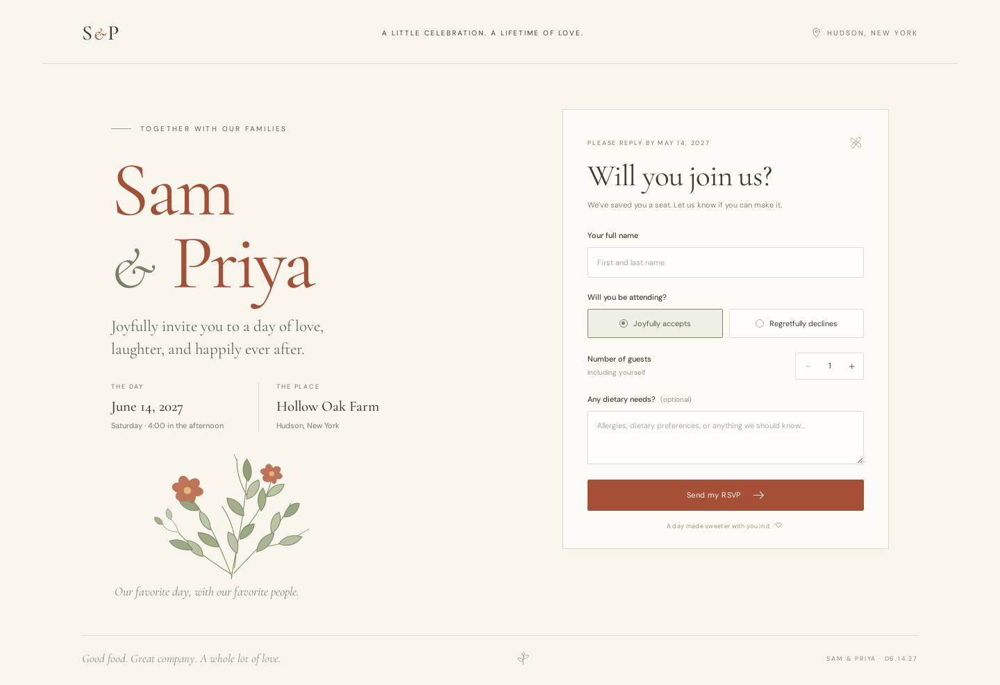</a> [phone](iteration-2/rsvp-page/baseline/run-1/shots/mobile-light.jpg) · [files](iteration-2/rsvp-page/baseline/run-1/output/) · [run 2](iteration-2/rsvp-page/baseline/run-2/shots/desktop-light.jpg) | <a href="iteration-2/rsvp-page/with-skill/run-1/shots/desktop-light.jpg">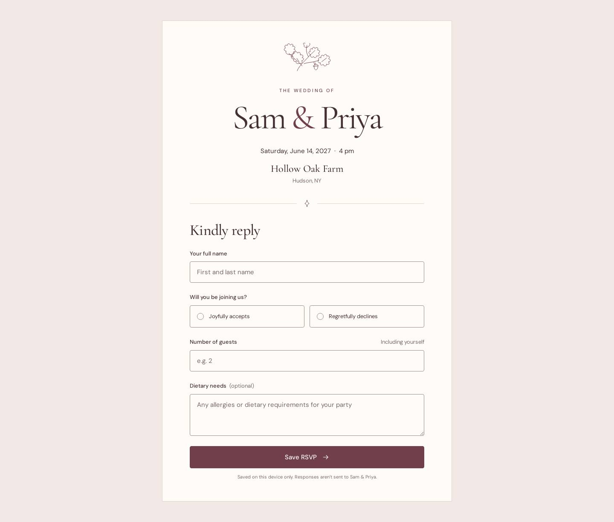</a> [phone](iteration-2/rsvp-page/with-skill/run-1/shots/mobile-light.jpg) · [files](iteration-2/rsvp-page/with-skill/run-1/output/) · [run 2](iteration-2/rsvp-page/with-skill/run-2/shots/desktop-light.jpg) | <a href="iteration-3/rsvp-page/with-skill/run-1/shots/desktop-light.jpg">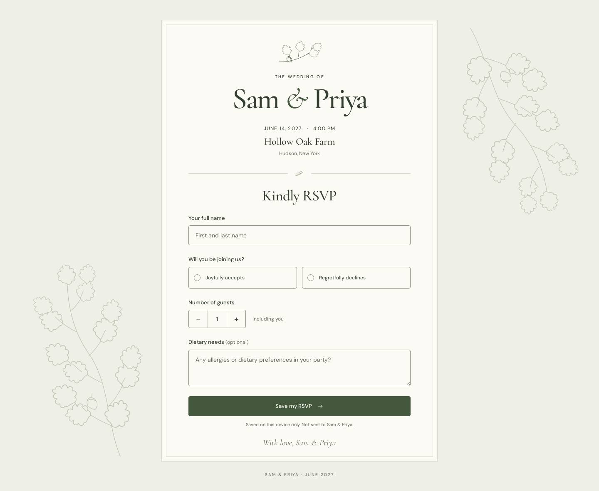</a> [phone](iteration-3/rsvp-page/with-skill/run-1/shots/mobile-light.jpg) · [files](iteration-3/rsvp-page/with-skill/run-1/output/) · [run 2](iteration-3/rsvp-page/with-skill/run-2/shots/desktop-light.jpg) | <a href="iteration-4/rsvp-page/with-skill/run-1/shots/desktop-light.jpg">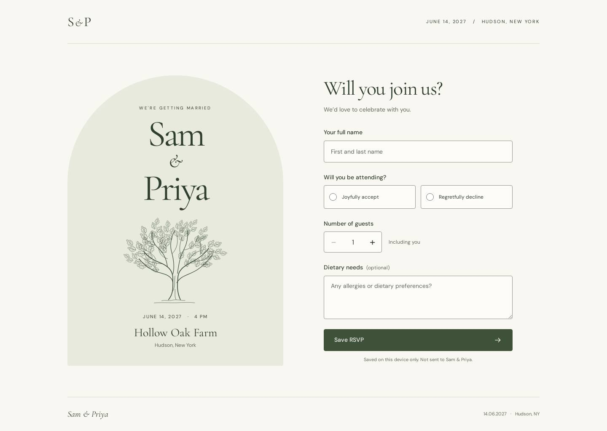</a> [phone](iteration-4/rsvp-page/with-skill/run-1/shots/mobile-light.jpg) · [files](iteration-4/rsvp-page/with-skill/run-1/output/) · [run 2](iteration-4/rsvp-page/with-skill/run-2/shots/desktop-light.jpg) |

## svg-animation

> Create a small animated SVG for the "You're all caught up" empty state of an email app. It should loop gently and not be distracting. Save it as caught-up.svg.

| baseline (iteration 1) | skill v1 | baseline (iteration 2) | skill v2 | skill v3 | skill v4 |
|---|---|---|---|---|---|
|  [files](iteration-1/svg-animation/baseline/run-1/output/) · [run 2](iteration-1/svg-animation/baseline/run-2/shots/filmstrip.jpg) |  [files](iteration-1/svg-animation/with-skill/run-1/output/) · [run 2](iteration-1/svg-animation/with-skill/run-2/shots/filmstrip.jpg) |  [files](iteration-2/svg-animation/baseline/run-1/output/) · [run 2](iteration-2/svg-animation/baseline/run-2/shots/filmstrip.jpg) |  [files](iteration-2/svg-animation/with-skill/run-1/output/) · [run 2](iteration-2/svg-animation/with-skill/run-2/shots/filmstrip.jpg) |  [files](iteration-3/svg-animation/with-skill/run-1/output/) · [run 2](iteration-3/svg-animation/with-skill/run-2/shots/filmstrip.jpg) |  [files](iteration-4/svg-animation/with-skill/run-1/output/) · [run 2](iteration-4/svg-animation/with-skill/run-2/shots/filmstrip.jpg) |
